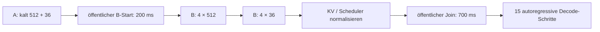

# Ausführbarer Protected Prefill Prototyp mit gemeinsamem Decode

Stand: 04.11.2026. Tatsächliche Implementierung und GPU-Prüfung mit
Qwen2.5-7B-Instruct, vLLM 0.17.1 und RTX 3090. Die installierte Engine
wurde nicht verändert; der Prototyp verwendet eine eigene Schedulerklasse
und zwei echte, partitionierte vLLM-KV-Manager. Keine Literaturkampagne,
kein neuer trainierter Angreifer.

Die anschließende formale Untersuchung steht konzentriert in
[Logische Nichtinterferenz bei Protected Prefill](protected-prefill-nichtinterferenz-20261103.md):
quellcodegebundener erfolgreicher logischer Wiedereintritt, expliziter
Backendvertrag und Fehler-/Timinggegenbeispiele. Dieser Engineeringbericht
enthält die vorherigen Entwicklungs- und Messstände; bytegleiche
Messinstanzen werden nicht mit einem allgemeinen Clientzeitbeweis
gleichgesetzt.

**Ergebnis:** Die bisher nur vorausgesetzte Normalisierung ist konstruiert.
In einem GPU-Kalt/Warm-Funktionstest sind nach dem Übergang sowohl die
kanonischen KV-Metadaten als auch die aktiven KV-Daten aller 28 Schichten
identisch. Ein SHA-256 über die tatsächlichen GPU-Daten nach dem Kopieren
stimmt überein; alle fünf 16-Token-Ausgaben ebenfalls. Der warme geschützte
Pfad nutzt dabei **512 private Cachetokens**, der kalte null.

Das ist ein funktionsfähiger Zustandsübergang. Eine allgemeine
Nichtinterferenzgarantie für physische GPU-/CPU-Zeiten oder ein
überlegener Privacy-Latency-Punkt ist dadurch noch nicht bewiesen.
Die gemessenen Kosten stehen unten; insbesondere steigt As Antwortzeit.

## Abschließende C3-Positivkontrolle: ungeschütztes Signal erkennbar

**Fall A: Die fehlende Positivkontrolle ist erfolgreich.** Unter `direct`
mit denselben 512/2048-Einstellungen unterscheiden beide vor dem Test
eingefrorenen Beobachter den privaten A-Cachezustand in **48/48** neuen
Prüfkohorten. Die experimentelle Arbeit für das Manuskript ist damit
abgeschlossen. Die Protected-Prefill-Entwicklung bleibt gestoppt.

### Vergleich mit den unveränderten bisherigen Beobachterwerten

Alle Zahlen aus unabhängigen Prüfdaten mit je 24 Warm/Kalt-Paaren pro
Policy. T1 ist die trainierte Erst-B-Schwelle, T2 die standardisierte
logistische Regression auf vier eigenen B-Latenzen und Fehlerbit.
Balanced Accuracy entspricht bei den ausgeglichenen Klassen der Accuracy.

| Policy, jeweils 512/2048 | T1 BA | T1 AUC | T2 BA | T2 AUC |
| --- | ---: | ---: | ---: | ---: |
| **Direct, neue Positivkontrolle** | **100,00 %** | **1,000** | **100,00 %** | **1,000** |
| Protected Prefill, bisheriges Gate | 54,17 % | 0,530 | 58,33 % | 0,528 |
| Ignore-Hits, bisheriges Gate | 39,58 % | 0,382 | 47,92 % | 0,387 |
| Release-only, bisheriges Gate | 41,67 % | 0,415 | 45,83 % | 0,413 |

Die alten drei Policies sind **keine gleichzeitig neu randomisierte
Vier-Policy-Serie**. Ihre Modelle, Messungen und Auswertungen bleiben
unverändert. Auch Ergebnisse unter Zufall werden nicht umgedreht. Die
Tabelle ordnet die Sensitivität des Beobachterrezepts ein; sie ist kein
neuer gepaarter Wirksamkeits- oder Kostenvergleich zwischen den Tagen.

### Vorab festgelegter Ablauf und Methodentreue

Neue Serie: `results/protected-prefill-direct-20261104-01/`.
Der vollständige Plan wurde am **04.11.2026 um 08:00:19 MEZ** gespeichert,
vor Beginn der GPU-Engineinitialisierung um 08:00:37 MEZ. Er enthält
72 Fälle, Codehashes, Versionen, GPU-Inventar, Auswertungsregeln,
Abweichungen und Hashes aller 900 vorher vorhandenen Ergebnisdateien.
Protokoll-SHA-256:
`4ea052cd171fa89db438f19fe48080ee1a02c1779e6a94bca54585e149ab9c94`.

Zwölf neue Trainingspaare, danach 24 neue Prüfpaare; Warm/Kalt innerhalb
jedes Paars mit vorab fixiertem Seed randomisiert. Keine Fallwiederholung,
keine Parameteränderung, kein Nachtrainieren oder Drehen der Testscores.
Numerische Modelle und StandardScaler stehen in `observers.json`;
`test-start.json` bindet deren Hash und liegt nachweislich vor dem ersten
Prüfrequest. T1 wählte nur im Training die Richtung „warm früher“ und
die Schwelle **894,9664 ms**; Trainingstrefferquote 23/24.

`src/protected_prefill_direct_control.py` ruft den **unveränderten**
`Pilot.case("direct", ...)` auf. Der gleiche Schedulerdelegationspfad
nutzt ohne konfigurierte geschützte Kohorte den nativen vLLM-Scheduler.
Keine Normalisierung, keine Join-Barriere, kein künstlicher Release und
kein `skip_reading_prefix_cache`. Modell und lokale Snapshotrevision,
vLLM 0.17.1, RTX 3090, Profiling, Eager-Modus, vier 548-Token-Dokumente,
16 greedy Ausgabetokens, Saltwerte, echte KV-Partitionen A=128/B=256,
Reset, Vorbereitung mit 512er-Chunks und 50-ms-Fallabstand entsprechen
dem alten Gate. Alle tatsächlichen Scheduler-/Workerbudgets sind 2048,
alle per-Request-Chunks höchstens 512.

Die neue Analyse übernimmt `_features`, `_observer_report`, Paarbildung
und Vorhersageregeln aus dem unveränderten Gate-Modul. Der neue
Fit-Einstieg akzeptiert genau die 24 neuen Direct-Trainingskohorten statt
72 über drei Policies gepoolte Trainingskohorten. Schwellenkandidaten,
Tie-Break, StandardScaler und `LogisticRegression(C=1, solver="lbfgs",
max_iter=1000)` sind identisch. Ein CPU-Fixture vor dem Freeze ergab
exakt gleiche numerische Schwellen, Richtungen, Skalierungen und
Koeffizienten wie das ursprüngliche Rezept. Alte Policy-Daten wurden
nicht zum Anpassen der Direct-Modelle verwendet.

**Dokumentierte Unterschiede:** separater Messzeitpunkt und nur eine
Policy statt drei verschachtelter Policies; neuer Seed; kein zusätzliches
geschütztes Funktionspaar vor der Serie, nur gewöhnliche Engineinitialisierung
und die unveränderte Vorbereitung vor jedem Fall. Direct nutzt nativ
**544** warme A-Tokens wie Release-only; Protected Prefill begrenzt sie
auf 512, Ignore-Hits auf null. Eine Begrenzung von Direct auf 512 hätte
seine private Wiederverwendung künstlich verändert. Gemessen wird
weiterhin Antwortverfügbarkeit im EngineCore-Harness, kein HTTP-Empfang.

### Unsicherheit, gepaarte Unterschiede und Integrität

5000 Bootstraps ziehen vollständige Warm/Kalt-Prüfpaare. BA und AUC
haben bei beiden Direct-Beobachtern die nominalen Paarbootstrapintervalle
**[1,000; 1,000]**. Diese Intervalle degenerieren bei fehlerfreier
empirischer Klassifikation; sie begründen keine perfekte Erkennung in
der Population oder außerhalb dieser 24 Paare. Der unverändert berechnete
gemeinsame Paar-Labeltauschtest über BA/AUC beider Beobachter ergibt
**p=0,000200** (5000 Ziehungen, +1-Korrektur). Die vorab festgelegte
Positivkontrollregel ist erfüllt: Konfiguration korrekt, keine fehlenden
Prüfantworten/Fehler, gemeinsamer p-Wert unter 0,05 und mindestens ein
Beobachter mit beiden nominalen Untergrenzen über 0,5.

| Prüfendpunkt, kalt minus warm | Mittel | Nominales 95-%-Paarbootstrapintervall des Mittels | Positive Paare |
| --- | ---: | ---: | ---: |
| Erste vollständige B-Antwort relativ zum ersten B-Versand | 113,39 ms | 103,96–123,03 ms | 24/24 |
| Median der vier eigenen B-Latenzen | 114,51 ms | 105,13–124,12 ms | 24/24 |
| As eigene Antwortlatenz | 135,65 ms | 126,32–145,34 ms | 24/24 |

Die erste B-Differenz reicht von 78,90 bis 177,74 ms, Median 108,05 ms.
Die zusätzlich verlangten Differenzintervalle verwenden denselben
5000-fachen Paarbootstrapansatz; sie sind deskriptiv/nominal, ohne neuen
Mehrfachvergleich oder policyübergreifende gepaarte Inferenz. Die
ursprünglichen Beobachterintervalle bleiben unverändert; sämtliche
acht BA-/AUC-Ergebnisse samt Intervallen stehen in `comparison.csv`.

**72/72 Kohorten und 360/360 vollständige Antworten**, keine Fehler,
keine fehlende Antwort, keine Wiederholung oder Ersatzengine nötig.
A hat in allen 36 warmen Kohorten 544 Hits, in allen 36 kalten null;
alle **288 B-Antworten** haben null Cachetreffer. Alle Releases stimmen
mit dem jeweiligen internen Abschlusszeitpunkt überein. Direct hat keine
öffentliche Deadline: „Overrun“ ist dort nicht definiert und wird nicht
als bestandene Verfügbarkeitsgarantie ausgegeben.
Alle acht Quellen und ihre Snapshots stimmen nach dem Lauf mit dem
Freeze überein; die vier erfassten installierten vLLM-Dateien, Prompts
und alle 900 alten Ergebnisdateien sind unverändert. Die GPU-Engine
ist beendet; kein Push.

### Verbindliche C3-Darstellung im Manuskript

Die fehlende Positivkontrolle ist geschlossen: Das bestehende
Zeitbeobachterrezept erkennt einen ungeschützten A-Cachekanal bei
512/2048 zuverlässig **im vorab fixierten unabhängigen Test**. Niedrige
Protected-Prefill-Werte können somit nicht allein mit einer prinzipiell
unempfindlichen Beobachterfamilie in dieser Konfiguration erklärt werden.
Sie sind aber weiterhin kein enger Schutzbeleg: Das alte gemeinsame
Schutzgate ist nicht bestanden, die Intervalle bleiben breit, die
Messzeitpunkte verschieden und das Fehlergegenbeispiel gültig.

C3 wird als **implementierte private Wiederverwendung mit normalisiertem
Wiedereintritt, beobachterbezogener Einordnung und konfigurationsgleicher
Kostenfallstudie** dargestellt. Der belegte warme CUDA-Intervallvorteil
gegen Ignore-Hits und die zusätzliche Antwortlatenz bleiben bestehen.
Keine vollständige Timinggarantie oder allgemeine überlegene
Schutzmethode behaupten. Der logische Beweis bleibt unterstützend.
C1 und C2 behalten ihre eigenen Beobachtungsmodelle und Daten.

Geeigneter englischer Ergebnissatz:

> In an independently acquired unprotected positive control with matched
> 512/2048 scheduling, both train-frozen timing observers classified all
> 48 held-out cohorts correctly (AUC 1.00). The previously collected
> protected-prefill results were much closer to chance, but their wide
> uncertainty intervals and the separate acquisition sessions preclude
> a timing-security guarantee. The implementation therefore establishes
> private reuse and a measured computation–latency tradeoff, supported
> by a conditional logical re-entry contract.

**Exakte Artefakte:** Im oben genannten Ergebnisordner liegen
`protocol.json`, `source/`, `engines/engine-000/start.json`, `engine.log`,
`trials.jsonl`, `observers.json`, `test-start.json`, `analysis.json`,
`verification.json`, `comparison.csv` und `paired-test-differences.csv`.
Die alten Vergleichswerte kommen unverändert aus
`results/protected-prefill-gate-20261103-01/analysis.json`.
Die Analyse steht in `src/protected_prefill_direct_analysis.py`.

**Nächster verbindlicher Schritt:** englisches Manuskript schreiben und
im offiziellen ICCAI-Format auf höchstens zehn einspaltige Seiten
einschließlich Referenzen setzen. Keine weitere experimentelle Phase.

## Vorheriger Hardwareentscheid: Zweistream-Prefill reicht nicht

**Der vorab festgelegte CUDA-Pilot besteht das Hardwaregate nicht.**
Kalt spart paralleles Prefill im Mittel 46,49 ms, gefordert waren 66 ms
plus 20 ms Reserve. Der Zweirunner-Scheduler wird auf Grundlage dieses
Tests **nicht implementiert**. Die bestehende Normalisierung und der
bereits gemessene private Rechenvorteil bleiben als Ergebnisse erhalten.
Keine weitere Architektur, Streampriorität, Batchgröße oder Parametersuche.

| A-Zustand | Seriell, Mittel | Zwei Streams, Mittel | Gepaarter Zeitgewinn |
| --- | ---: | ---: | ---: |
| **Kalt, 12 Paare** | **618,15 ms** | **571,66 ms** | **46,49 ms** |
| Warm, 6 Paare | 490,98 ms | 480,84 ms | 10,14 ms |

Einseitige 95-%-Bootstrap-Untergrenze des mittleren kalten Gewinns:
**40,10 ms**, gegenüber der vorab geforderten 86-ms-Grenze. Die kalten
Einzelpaargewinne reichen von 21,16 bis 67,54 ms; es wurden keine günstigen
Paare ausgewählt. Der langsamste parallele kalte Lauf benötigt 589,28 ms.
Bis zum zuvor berechneten öffentlichen Joinlimit 589,43 ms blieben damit
nur 0,15 ms, obwohl vollständige Hostintegration und KV-Normalisierung
noch hinzukommen. Die medianen kalten Zeiten betragen 613,99/566,80 ms.

### Was tatsächlich gemessen wurde

Eine feste neue Serie unter
`results/protected-prefill-cuda-20261103-01/`: zwölf kalte und sechs warme
Vergleichspaare, Reihenfolge der Paare und Modi vorab randomisiert.
Vor der Messserie acht feste, nicht ausgewertete Warmupläufe. Protokoll,
Quellcodehashes und Erfolgskriterien wurden vor dem Laden der GPU-Engine
gespeichert; der Code blieb über den Lauf unverändert.

Der minimale Pilot `src/protected_prefill_cuda_pilot.py` übernimmt vier
**echte** Forward-Eingaben aus dem bestehenden vLLM-Prefill: A512, A36,
B2048=4×512 und B144=4×36. Eingaben, Attention-Metadaten und Slotmappings
werden pro Form kopiert, die Qwen-Modellgewichte nicht. Warmes A liest
die nach dem tatsächlichen A512-Forward gespeicherten 32 KV-Blöcke und
berechnet nur A36. Die KV-Lese-/Schreibbereiche von A und B sind disjunkt.

Dieselben Original-Eager-Forwards inklusive Logits und GPU-Argmax laufen
seriell beziehungsweise auf zwei CUDA-Streams. Ein einziger Hostthread
reiht die Python-Forwards nacheinander ein; der globale Forwardkontext
wird nicht von konkurrierenden Pythonthreads überschrieben. Im
Parallelmodus wird B zuerst eingereiht, anschließend A; die jeweiligen
Endstücke folgen erst auf ihr eigenes Abschlussereignis. Vollständiger
Device-Sync beendet die Zeitmessung. **Keine CUDA-Graphs und kein zweiter
Scheduler oder zweites Modell.**

Gemessen wird `perf_counter` vom ersten Enqueue/Event bis zur vollständigen
Synchronisierung, einschließlich Eager-Host-Enqueue, Warten auf
Zwischenergebnisse und GPU-Konkurrenz. Die CUDA-Zeitachsenhülle stimmt
nahe mit diesen Gesamtzeiten überein. KV-Restore, Korrektheitsprüfsummen
und der feste 50-ms-Abstand vor jedem Versuch liegen außerhalb der Zeit.
Nicht enthalten sind der vollständige Scheduler, dynamische CPU-
Eingabevorbereitung, sämtliche Sampler-/Antwortaufbereitung und die
kanonische Kopie. Diese ausgelassenen Arbeiten begünstigen die
Machbarkeitsschätzung; sie können den negativen Befund nicht retten.

Die vorab gewählten Bedingungen waren: kalter gepaarter Gewinn mit
einseitiger 95-%-Untergrenze mindestens 66+20=86 ms und maximale gemessene
Parallelzeit höchstens 542,43 ms. Die zweite Grenze lässt vom Joinlimit
589,43 ms 20 ms Host-/Samplerbudget, 7 ms Normalisierung und 20 ms Reserve.
Diese Budgets sind Entwicklungsannahmen, keine bewiesenen Worst-Case-
Schranken. Der Versuch verfehlt bereits die 66 ms ohne Reserve.

### Korrektheit und Konkurrenz

Alle 36 gemessenen Ausführungen liefern identische aktive KV-Daten über
**175 Quellblöcke je 28 Schichten**, ebenso bitgleiche Frontier-Logits und
gleiche Argmax-Tokens, auch zwischen warm und kalt. Eingaben enthalten
die echten Positionsbereiche 0–511 beziehungsweise 512–547. Gewicht-,
Rotarycache- und KV-Speicheradressen bleiben unverändert. Jede Attention-
Schicht hat die einmalige KV-Skalenberechnung abgeschlossen, und der
vLLM-Streamcache stimmt mit dem jeweils ausgewählten PyTorch-Stream
überein. Es wurde kein versteckter Defaultstream als Parallelmodus gezählt.

Die Konkurrenz ist in den Streamintervallen sichtbar: B2048 benötigt
kalt seriell median etwa 418 ms, parallel etwa 496 ms; A512 liegt im
Parallelmodus lange in Konkurrenz zur B-Kette. Solche Eventintervalle
enthalten auch Queue-/Enqueuezeiten und sind keine isolierten
Kernellaufzeiten. Überlappende Streamintervalle dürfen nicht als
gleich große eingesparte GPU-Zeit addiert werden. Entscheidend bleibt
der reale **46,49-ms-Gesamtgewinn**, der die Hardwareannahme für den
vorgesehenen Latenzpfad nicht ausreichend trägt.

Reproduktion mit neuem Ausgabeordner:

```bash
/home/rock/projects/porto/.venv-py313-repair/bin/python \
  src/protected_prefill_cuda_pilot.py results/protected-prefill-cuda-NEUER-LAUF
```

`protocol.json`, `setup.json`, `trials.jsonl`, `analysis.json` und
`verification.json` halten Ablauf, Eingaben, Messung und Entscheidung
fest. Der Test ist eine Hardwareentscheidung, kein neuer Schutz- oder
Leakagenachweis. Frühere Messungen und der vorhandene Scheduler bleiben
unverändert; nach Abschluss läuft keine GPU-Engine weiter.

## Vorherige Konstruktionsprüfung: kritischen Pfad um 110 ms verkürzen

**Befund:** Mit den bisherigen seriellen Operationen belegen die vorhandenen
Traces keine 110 ms kürzere Latenz. Eine konkrete strukturelle Möglichkeit
ist paralleles, bis zum festen Join verborgenes A-/B-Prefill in getrennten
Ausführungskontexten. Dafür sind etwa **31–66 ms effektive Überlappung**
erforderlich. Ob diese auf der RTX 3090 unter realer Konkurrenz entstehen,
ist aus den vorhandenen Traces nicht feststellbar. Deshalb entsprechend
dem Auftrag **kein neuer Enginecode, kein GPU-Lauf, keine Parametersuche**.
Die nachfolgende Konstruktion ist ein implementierbarer Ablauf mit einer
quantifizierten offenen Bedingung, kein bestätigter Latenzvorteil.

Datengrundlage ausschließlich die 72 bereits gemessenen geschützten
Kohorten des Contribution-Gates. Extrahierte Phasen und Rechnungen:
`results/protected-prefill-critical-path-20261103/phase-records.jsonl`
und `analysis.json`. Frühere Prüfdaten dienen hier zur Konstruktion,
nicht als unabhängige Bestätigung eines neuen Ablaufs.

### Welche Abhängigkeit trägt die 700-ms-Barriere?

| Abschnitt | Kalt, Median | Warm, Median | Abhängigkeit |
| --- | ---: | ---: | --- |
| Einreichen/erster Aufruf | 6,36 ms | 6,43 ms | Kohorte muss geschlossen vorliegen |
| A-Prefill, tatsächliche Modellaufrufspannen | 140,64 ms | 21,72 ms | kalt 512+36, warm nur 36; KV-Rechenform identisch |
| Warten zwischen A-Ende und B-Start | 53,33 ms | 172,45 ms | B beginnt öffentlich bei 200; warme Einsparung darf diese Grenze nicht bestimmen |
| B-Prefill | 468,18 ms | 469,05 ms | 4 × 512, danach 4 × 36, mit eigener Datenabhängigkeit |
| Kanonische Normalisierung | 3,80 ms | 3,86 ms | erst nach vollständigem Prefill und Sampling beider Mandanten |
| Warten nach Normalisierung bis Join | 26,43 ms | 25,57 ms | gemeinsame Freigabe öffentlich bei 700 |
| 15 gemeinsame Decode-Aufrufe | 321,11 ms | 322,04 ms | Tokenfolge autoregressiv; keine 15 unabhängigen GPU-Aufgaben |

Die Aufrufspannen messen Schedulerstart bis GPU-Ausgabe/Update und
enthalten Hostanteile. Sie sind **keine isolierten Kernelzeiten**.
Zwischen den 15 Decode-Aufrufen liegen außen zusätzlich nur etwa 1,85 ms
Schedulerlücken. Host-/GPU-Lücken innerhalb der Aufrufe sind nicht separat
aufgelöst; einen CUDA-Graph-Gewinn kann man daraus nicht quantifizieren.



Für eine cacheunabhängige öffentliche Planung zählt auch kaltes A:
dessen letzter Output liegt median bei 147,15 ms und im vorhandenen
Material spätestens bei 159,78 ms. Nur die warme A-Laufzeit zur Verkürzung
des öffentlichen Slots zu verwenden wäre eine andere Schutzannahme.

Streiche ich im selben seriellen Operationsmodell **jede** Warte- und
Steuerungslücke und kombiniere sogar die schnellsten Operationen aus
verschiedenen kalten Läufen, bleiben **929,74 ms ab Kohortenepoch**.
Mit dem beobachteten Versandversatz entspricht das etwa **926,57 ms
eigener B-Latenz**, gegenüber Ignore-Hits warm 910,87 ms. Die Summe der
Operationsmediane liegt bei 939,83 ms ab Epoch. Diese Werte sind bewusst
optimistische Trace-Replays, **keine universellen Hardwareuntergrenzen**.
Sie zeigen, dass das bloße Streichen der Barrieren die nötigen 110 ms
unter unveränderten Operationskosten nicht begründet.

### Geprüfter früherer Übergang: bei 512 statt548 Tokens

Ein Join bei 512 verarbeiteten Tokens würde A-/B-Endstücke aus der
geschützten Phase entfernen. Danach stehen aber noch **5×36=180
Prompttokens** vor dem ersten Ausgabetoken auf demselben Antwortpfad.
Die Arbeit verschwindet nicht durch Umbenennen der Phase.

Mit den vorhandenen Operationsmedianen und dem bisherigen Decode-Pfad
dürfte dieser gemeinsame Endstückaufruf höchstens **48,10 ms** dauern,
um die B-Latenz von Ignore-Hits zu erreichen. Bereits B allein benötigt
für144 Endstücktokens median56,18 ms. Es gibt keinen gemessenen passenden
180-Token-Aufruf. Ein positiver Befund würde somit einen zusätzlichen
Ausführungsgewinn voraussetzen, nicht nur eine verschobene Join-Grenze.

Außerdem erzwingen `plan_canonical()` und `commit_canonical()` gegenwärtig
548 Prompttokens plus ein Ausgabetoken. Warmes A bei 512 müsste ohne
Forward-Aufruf in den Worker übernommen werden. Diese Normalisierung
ist technisch konstruierbar, wäre aber eine neue Frontier mit neuem
Funktionsnachweis. **Kein positiver 110-ms-Befund für diesen Umbau.**

### Konkrete Bauhypothese: gleichzeitiges geschütztes Prefill

Die Datenabhängigkeiten *innerhalb* von A beziehungsweise B sind nötig.
Eine mathematische Datenabhängigkeit *A fertig → B-Prefill starten*
besteht bei getrennten Tenant-KV-Daten dagegen nicht. Sie stammt aus
unserer bisherigen Ausführungsstruktur. Dieser Rand lässt sich entfernen,
ohne A und B in geheimnisabhängig verschieden große Modellbatches zu
mischen und dadurch die bisherige numerische Rechenform zu verlieren.

Implementierbarer Ablauf:

1. Die fünf Requests sind vor der öffentlichen Epoch vollständig bekannt.
   Zwei dauerhaft vorbereitete Runnerkontexte verwenden dieselben
   unveränderlichen Modellgewichte, aber getrennte Eingabepuffer,
   `input_batch`, Samplingzustände und CUDA-Streams. KV bleibt in den
   bestehenden physischen Tenantpartitionen. Keine zweite Modellkopie.
2. Öffentlich beginnt B-Prefill bei 0 statt200. Die separate A-Ausführung
   wird ebenfalls im geschützten Anfangsabschnitt eingereiht. B behält
   fest die Aufrufe4 × 512 und4×36; A kalt512+36, warm36 mit512 Reuse.
   A gibt kein Signal, auf dessen Grundlage zusätzliche B-Arbeit oder
   eine weitere Kohorte in freie Zeit eingeschoben wird.
3. Vor dem Warten auf Sampling/CPU-Ergebnisse müssen beide unabhängigen
   Forward-Aufrufe eingereiht sein, sonst serialisiert der Host die
   vermeintliche Parallelität. Folgeschritte hängen jeweils nur vom
   eigenen Stream ab. Keine B-Zwischenausgabe; nur die geschlossene
   Kohorte, kein zusätzlicher Timingprobe-Request während des Prefills.
4. Sind beide exakten Frontiers erreicht, wird **beide Streams umfassend**
   synchronisiert. Erst dann dieselbe Snapshot-/Clear-/Scatter-Kopie und
   derselbe KV-Managerneuaufbau. Die öffentliche Freigabe hängt weiterhin
   von einer festen J-Grenze ab, niemals von privater Bereitschaft.
5. Vor J übernimmt ein gemeinsamer Runner alle fünf vollständigen
   `CachedRequestState`-Objekte, inklusive des bereits erzeugten Tokens,
   und erhält deterministische Eingabereihenfolge sowie kanonische
   Blocktabellen. Der vorhandene Remappingpfad kann anschließend wieder
   alle fünf als bestehende Requests behandeln. Nur `NewRequestData`
   zu senden genügt nicht: dieser Pfad initialisiert `output_token_ids=[]`.
6. Danach dieselben15 gemeinsamen Decode-Schritte. Überschreitung beendet
   die Kohorte; keine früh freigegebene Teilmenge und keine Verlängerung
   der öffentlichen Grenze. Private Scratch-/Allocatorzustände und
   Eingabepuffer müssen vorab fest bereitgestellt beziehungsweise am
   Übergang kontrolliert werden; Bytegleichheit und Timing bleiben
   Prüfpflichten eines tatsächlich gebauten Pfads.

Warum nicht einfach zwei Threads auf dem vorhandenen Runner? Installierter
vLLM-Code weist `execute_model()` bei belegtem `execute_model_state` zurück;
erst `sample_tokens()` leert ihn. Eingabebatch und Zwischenresultate sind
ebenfalls veränderlich. `forward_context.py` verwendet zudem einen globalen
Forwardkontext. Der konkrete Weg sind deshalb getrennte Runnerzustände,
sequenzielles Host-Enqueue der jeweiligen Forwardkontexte auf getrennte
GPU-Streams und expliziter Zustandstransfer vor dem gemeinsamen Decode.
Zwei unabhängige Threads mit demselben Runner wären keine Implementierung
dieses Plans.

**Kostenbedingung:** B warm 910,87 ms minus bisheriger Restpfad nach Join
321,43 ms ergibt einen nötigen öffentlichen Join von höchstens **589,43 ms**.
Die seriell addierte Vorbereitung einschließlich kleiner Kontrollanteile
liegt nach Medianen bei620,26 ms; eine unabhängige Hülle der beobachteten
Maxima bei655,06 ms. Effektive Überlappung abzüglich neuer Konkurrenz- und
Orchestrierungskosten müsste folglich **30,83 bis 65,63 ms** ausmachen,
zuzüglich einer neu zu begründenden Reserve. Bei idealer Überlappung läge
die Vorbereitung rechnerisch bei etwa 479 ms. Die Abhängigkeitsstruktur
lässt das Ziel also zu; sie beweist die nötige Hardwareüberlappung nicht.

Die vorhandenen Traces stammen sämtlich aus serieller Ausführung. Sie
enthalten weder gleichzeitige Kernellaufzeiten noch SM-/Bandbreitenbelegung.
CUDA-Streams könnten dieselben Ressourcen nur gegenseitig verlangsamen.
Aus theoretischer Spitzenleistung lässt sich hier keine nutzbare freie
Kapazität ableiten. **Kein positiver Hardware-Machbarkeitsbefund und deshalb
keine Implementierung aufgrund dieser Daten allein.** Ein einfach auf 589 ms
heruntergesetzter Timer wäre ausdrücklich nicht diese Konstruktion.

### Öffentlich geplante Mehrkohorten-Alternative

Ein konkret abbildbarer Ablauf gruppiert zwei vollständige Kohorten:
C0 geschützt 0–700, C1 geschützt 700–1400, anschließend 15 gemeinsame
Decode-Aufrufe für zehn Requests. C0 wartet nach seiner Normalisierung
bis zur öffentlichen Gruppengrenze. Slots und Belegung werden vorab
festgelegt; keine Verwendung nur wegen warmer Treffer frei gewordener
GPU-Zeit. C1 muss in einer eigenen physischen Partition liegen, damit
seine Normalisierung C0 nicht löscht.

Erforderliche Eingriffe sind benennbar: `max_num_seqs` mindestens 10
statt 8, zwei feste Kohortenpartitionen mit bisherigen 128/256-Blöcken
je Kohorte, insgesamt mindestens 769 physische Blöcke inklusive Nullblock
(beispielsweise 1024), kohortenspezifische Clearbereiche und gemeinsames
Worker-Remapping aller zehn Requests. Das ist ein öffentlicher
Pipeline-/Gruppenablauf, kein opportunistisches Füllen privater Lücken.

Sei D5 die Ausführungsspanne für 15 Schritte mit fünf Requests und D10
diejenige mit zehn. Die Einsparung je Kohorte wäre **D5−D10/2**.
Aus D5 ≈ 321,89 ms ergibt sich für 110 ms weniger *Engine-Ausführungszeit*
je Kohorte die Bedingung **D10≤ 423,77 ms**, etwa 28,25 ms je Aufruf.
Das ist eine Rechengrenze, keine Messung von D10. Phasenspezifische
CUDA-Ereigniszeiten sind in den alten Rohdaten nicht separat gespeichert;
die 322 ms dürfen nicht als isolierte GPU-Kernelzeit ausgegeben werden.

An dieser Bedingungsgrenze würde ein Rahmen etwa 1824 ms dauern.
Bei öffentlichem Eintritt von C0 bei 0 und C1 bei 700 wären deren
Antwortlatenzen etwa **1824 und1124 ms**, obwohl der mittlere
Serviceabstand nur 912 ms je Kohorte beträgt. **Durchsatz ist hier kein
Latenzgewinn.** Noch früheres Einreichen von A außerhalb der gemessenen
Kohorte würde dieselbe Arbeit lediglich vor den gewählten Messursprung
verschieben. Auch das wäre kein fairer Latenzvorteil.

Die vorhandene Engine war auf acht Requests begrenzt; ein gemessener
Zehner-Decode fehlt. Ein Kostenvergleich müsste zudem Ignore-Hits dieselbe
Gruppierung erlauben. Der Ablauf ist deshalb eine konkrete Alternative
für GPU-/Servicekosten und Durchsatz, **kein aus den Traces bestätigter
110-ms-Latenzumbau**. Aktueller Abschluss: serielle Leerlaufbeseitigung
reicht nicht; paralleles geschütztes Prefill ist die quantifizierte
Bauhypothese, deren entscheidende Überlappungsbedingung noch unbelegt ist.

## Vorheriger Befund: Contribution-Gate bei gleichen 512/2048-Einstellungen

**Das Gate ist insgesamt nicht bestanden.** Der Rechenvorteil bei warmem
A bleibt erhalten. Der frühere Latenzvorteil gegenüber Ignore-Hits bestätigt
sich bei angeglichener Konfiguration nicht. Die neue Beobachterprüfung
findet keinen signifikanten Kanal, ist aber zu ungenau für den vorab
geforderten begrenzten Schutzbefund. Die bestehende Konstruktion bleibt
als funktionierender Engineeingriff erhalten.

### Vorab festgelegter Vergleich

`results/protected-prefill-gate-20261103-01/` enthält eine vollständig neue
Serie: drei Verfahren, je zwölf Trainingspaare und anschließend 24 neue
Prüfpaare. Insgesamt 216 Kohorten/1080 Vollantworten, davon 72 Trainings-
und 144 Prüfkohorten; 48 Prüfkohorten pro Verfahren. Ganze Warm/Kalt-Paare
sind getrennt. Verfahren und Reihenfolge der beiden Zustände sind innerhalb
der öffentlichen Paarblöcke randomisiert. Modell, Prompts, Ausgabe von
16 Tokens, GPU, Quoten, Reset und Instrumentierung sind gleich.

**Alle Verfahren verwenden 512-Token-Chunks und ein 2048-Token-Budget**,
einschließlich Cachevorbereitung und gemeinsamem Decode; Workerpuffer
ebenfalls 2048. Jede tatsächliche Kostenkohorte trägt diese Einstellungen
im Rohdatensatz. Die Auswertung prüft sie sowie die tatsächlich geplanten
Tokenzahlen. Die Isolation bestimmt weiterhin unterschiedliche konkrete
Batchzusammensetzungen; gerade ihre Kosten gehören zum Methodenvergleich.
Release-only darf nativ 544 private Tokens lesen, Protected Prefill
weiterhin 512, Ignore-Hits keine. B liest in allen Fällen null Treffer.

Der Normalisierer und die KV-Manager wurden nicht geändert. Neu ist nur
die Konfigurationsanbindung des vorhandenen Piloten für die Kontrolle.
J bleibt 700 ms. Kein neuer Schutzalgorithmus, keine Parametersuche und
keine Literaturrecherche. Der vollständige Plan wurde am
03.11.2026 um 13:45:21 UTC vor dem ersten GPU-Fall gespeichert.
Quellcodekopien und SHA-256 stehen unter `source/` und in `protocol.json`.
Nach Beginn der Serie wurden weder Code noch Einstellungen verändert.

Zwei vorgegebene Zeitbeobachter pro Verfahren wurden nach allen
Trainingsfällen gespeichert, **vor jeder Prüfmessung**:

- Schwelle samt Richtung auf Bs erstem vollständigen Empfang relativ
  zu Bs erstem Versand; beide Parameter ausschließlich aus Training.
- Standardisierte logistische Regression, C=1 ohne Suche, auf den vier
  dokumentgebundenen eigenen B-Antwortlatenzen und einem Fehlerbit.
  Skalierung und Modell ausschließlich aus Training.

Kein Beobachter erhält As Zeiten, Cachezähler, Engineepoch oder
Fallnummern. Fehler wären als Status und eigene Fehlerverfügbarkeit
enthalten; kein Overrun wird herausgefiltert oder wiederholt. Ein
Fehler beendet die Engine und zählt, danach setzt ein frischer Prozess
mit dem nächsten vorab geplanten Fall fort. Diese Wiederherstellung
wurde im Messlauf nicht benötigt.

### Ergebnis der Konfigurationskontrolle

Mediane ausschließlich der neuen **Prüfdaten**. B bezeichnet den Median
der vier eigenen Latenzen innerhalb einer Kohorte, danach den Median
der 24 Kohorten je Zustand. CUDA umfasst Inferenzintervalle plus
Normalisierungskopie, ohne öffentliche Wartefenster.

| Verfahren, jeweils 512/2048 | A warm / kalt | B warm / kalt | CUDA warm / kalt |
| --- | ---: | ---: | ---: |
| Protected Prefill, J=700 | 1024,69 / 1024,68 ms | 1021,61 / 1021,17 ms | 814,52 / 933,68 ms |
| Ignore-Hits | 912,94 / 910,97 ms | 910,87 / 908,84 ms | 922,82 / 921,58 ms |
| Release-only, B bei 1240 | 784,63 / 912,72 ms | 1240,07 / 1240,07 ms | 795,03 / 922,71 ms |

Der gepaarte warme Vergleich mit Ignore-Hits zeigt:

- A ist mit Protected Prefill im Mittel **110,02 ms langsamer**, B
  **108,82 ms langsamer**. In allen 24 warmen Prüfpaaren ist Ignore-Hits
  für beide Endpunkte schneller. Der frühere Latenzvorteil war somit
  nicht gegenüber effizient konfigurierter Neuberechnung abgesichert.
- CUDA-Inferenz plus Kopieren spart dagegen im Mittel **107,99 ms**.
  Die simultan abgesicherte einseitige Bootstrap-Untergrenze beträgt
  **102,67 ms**. Nach Medianen etwa **11,7 %** weniger als Ignore-Hits;
  der frühere 32-%-Abstand schrumpft deutlich. Private Wiederverwendung
  bleibt real: 2303 statt 2815 geplante Tokens, also 512 weniger.
- Kalt liegt das geschützte CUDA-Intervall etwas über Ignore-Hits.
  Gegen Release-only gewinnt B Latenz, A bleibt warm deutlich langsamer;
  auch das warme CUDA-Intervall von Release-only ist kürzer. Eine
  Überlegenheit über alle Zustände und Ressourcen wird nicht behauptet.

Bootstrap zieht ganze Prüfpaare, nicht vier B-Antworten als unabhängige
Wiederholungen. Der Kostenendpunkt ist die **mittlere gepaarte Differenz**,
die Tabelle zeigt deskriptive Mediane. Drei Kostenendpunkte erhalten
gleichzeitig einseitige 95-%-Untergrenzen über alpha=0,05/3.
CUDA-Ereignisse enthalten Dispatchlücken; keine reine Kernel- oder
Energiemessung. Cachevorbereitung liegt wie bisher außerhalb der
Kohortenlatenz. Alle Policies laufen im selben instrumentierten
Engineprozess; der neue Vergleich ist kein HTTP-Test.

### Zeitbeobachter auf den zurückgehaltenen Prüfdaten

| Verfahren | Trefferquote Schwelle / Regression | AUC Schwelle / Regression |
| --- | ---: | ---: |
| Protected Prefill | 54,17 / 58,33 % | 0,530 / 0,528 |
| Ignore-Hits | 39,58 / 47,92 % | 0,382 / 0,387 |
| Release-only | 41,67 / 45,83 % | 0,415 / 0,413 |

Trefferquote bedeutet Balanced Accuracy; beide Klassen sind gleich groß.
Vorhersagen und Scoreorientierung bleiben aus dem Training übernommen,
auch bei Ergebnissen unter 0,5. Keine nachträgliche Vorzeichenumkehr,
kein Nachtrainieren auf Prüfdaten. Die Baselines sind Vergleichskontrollen;
der vorab festgelegte primäre Schutztest betrifft Protected Prefill.

Für das begrenzte Schutzgate muss zusätzlich zur fehlenden Signifikanz
die einseitige 95-%-Obergrenze der größten absoluten Abweichung von 0,5
über **BA und AUC beider Beobachter** unter 0,15 liegen. Diese gemeinsame
Statistik berücksichtigt auch einen Rangkanal trotz schlechter Schwelle
oder umgekehrter Testorientierung; sie ändert keine Vorhersagen.
5000 gepaarte Labelvertauschungen und 5000 Paar-Bootstraps waren vorab
festgelegt. Die Grenze ist eine Pilotauflösung, kein allgemeines
akzeptables Sicherheitsniveau.

Protected Prefill: gemeinsamer zweiseitiger Permutationswert **p=0,595**,
aber gemeinsame Bootstrap-Obergrenze **0,215 statt unter 0,15**.
Damit **kein belastbarer Nachweis von Unterscheidbarkeit durch diese
Beobachter**, zugleich **kein hinreichend enger Schutzbefund**. Zum
Beispiel reicht das 95-%-Bootstrapintervall der Regressions-AUC etwa
von 0,345 bis 0,719. Eine hohe Unterscheidbarkeit ist nicht ausreichend
ausgeschlossen. Der erste-B-Medianunterschied kalt minus warm beträgt
hier nur −0,14 ms; auch dieser kleine Wert ist kein Leakage-Oberlimit.

### Normalisierung, Verfügbarkeit und Entscheidung

Der separate neue Funktionspaar-Test liefert wieder denselben aktiven
KV-Hash aller 28 Schichten wie vor dem Gate:
`878c99dbc44abe2a316f897035eab553c18138f75782b330536e7b10c6b0284c`.
Kanonische Metadaten, Queues, Frontier, Quoten und Worker-Remapping
bestehen auf allen erfolgreichen geschützten Messkohorten. Alle fünf
Tokenfolgen sind über sämtliche **72** geschützten Kohorten identisch.
Die teure KV-Prüfsumme wurde nur im separaten Funktionspaar mit festem
Zusatzbudget ermittelt; keine Behauptung eines Bytevergleichs in jeder
Kostenkohorte.

**0 Overruns bei 72 geschützten Kohorten**, keine späte B-Antwort bei
Release-only. Tatsächlicher Join 700,085–700,248 ms, kleinste beobachtete
Normalisierungsreserve **8,75 ms**. Der nominale einseitige 95-%-
Clopper-Pearson-Wert für mindestens einen Fehler je Warm/Kalt-Paar ist
bei 0/36 noch **7,98 %**; er setzt unabhängige Paarblöcke voraus und ist
keine allgemeine Hardwaregarantie. Das vorher festgelegte Verfügbarkeitsgate
ist bestanden, die Reserve bleibt knapp.

Ergebnis: Konfiguration, Normalisierung, beobachtete Verfügbarkeit und
warmer Rechenvorteil bestanden; Latenzvorteil und begrenztes Schutzgate
nicht bestanden. **Private Reuse, nachgewiesene Beobachtungsarmut und
geringere Kosten sind hier noch nicht gleichzeitig nachgewiesen.**
Der Befund verwirft den implementierten Übergang nicht; er korrigiert
den früheren Latenzclaim und trennt den bestätigten Rechenvorteil von
der offenen Schutzwirkung. Kein neuer Algorithmus aus diesem Gate
abgeleitet oder nachträglich optimiert.

Reproduktion mit neuem Ordner:

```bash
/home/rock/projects/porto/.venv-py313-repair/bin/python \
  src/protected_prefill_gate.py results/protected-prefill-gate-NEUER-LAUF
```

`protocol.json`, `observers.json`, `test-start.json`, `trials.jsonl`,
`functional-checks.jsonl`, `analysis.json` und `verification.json`
enthalten Plan, Freeze, Rohdaten und Entscheidung. Alle 74 im Protokoll
erfassten früheren Rohdateien sind unverändert. Keine GPU-Engine läuft
weiter; kein Push und kein Commit erstellt.

## Vorheriger Optimierungspilot: feste Blöcke und Schlussphase

Der anschließende Auftrag behält die obige Normalisierung bei und ändert
genau den geschützten Ausführungspfad. In den vorhandenen `pilot04`-Traces
benötigten kaltes A und die vier B-Requests jeweils neun Modellaufrufe:
acht 64-Token-Chunks plus 36 Tokens. B belegte damit etwa 598–623 ms.
Die kleinen Chunks stammen aus dem allgemeinen Scheduler; innerhalb
der bereits exklusiven Tenantphase ist dieses feine Interleaving unnötig.

Der neue Modus **`protected_block512`** verwendet öffentlich feste
512-Token-Chunks und ein 2048-Token-Batchbudget für vier B-Requests.
Kaltes A und B benötigen damit jeweils zwei Aufrufe, warmes A weiterhin
einen 36-Token-Aufruf. Cacheherkunft und kaltes A verwenden beide die
neue Rechenform 512+36; warmes A liest dieselben ersten 512 Tokens.
Alle bestehenden KV-Partitionen, Kopien, Quoten, Frontierprüfungen und
Worker-Tabellenersetzungen bleiben erhalten. Vor jedem gemeinsamen
Decode sind Schedulerbudget und Chunkgrenze wieder **256 und 64**.

**Öffentlicher Join: 700 statt 940 ms.** A erhält [0,200] ms; das
geschützte Schlussfenster [200,700] ms enthält B-Prefill **und** die
vollständige Normalisierung. Diese darf innerhalb der Isolation beginnen,
sobald die fünf Frontiers vollständig erreicht und alle GPU-Ausgaben
abgeholt sind. Gemeinsames Decode wartet immer auf J=700, auch wenn
Normalisierung früher endet. Keine geheimnisabhängige Frühfreigabe oder
Auswahl einer bereiten Teilmenge. Das ist weiterhin eine feste volle
Kohorte, keine Implementierung beliebiger selektiver Teilkohorten.

Die Entwicklung enthält einen wichtigen gescheiterten Zwischenschritt:
Der vorab gewählte Plan teilte dasselbe J=700 zunächst in A bis 200,
B bis 650 und 50 ms Normalisierungsreserve. `kv01` und `kv02` scheiterten
an dieser zusätzlichen B-Frist; im erhaltenen `kv02`-Trace endete B bei
669,98 ms (412,84 ms für 4×512 plus 56,53 ms für 4×36). Daraufhin wurden
B und Normalisierung zu **einem** geschützten Fenster verbunden. Der
öffentliche Join blieb 700. Dies ist eine anhand des Entwicklungsfehlers
konstruierte Reparatur, keine rein aus alten Daten vorhergesagte Schranke.
Beide Pläne und beide Fehlläufe bleiben erhalten. Nach dem Funktionstest
wurde der Kostenvergleich ohne weitere Anpassung ausgeführt.

Die Budgets sind ein überprüfter Prototypvertrag, keine bewiesenen
Worst-Case-Laufzeiten der GPU. Bei Überschreitung durch einen Modellschritt
oder die gesamte Normalisierung bricht der Prototyp ab. Im Kostenpilot
endete die Normalisierung bei 675,71–689,19 ms; die kleinste beobachtete
Reserve betrug somit nur 10,81 ms. Last- und Hardwareübertragbarkeit ist
damit offen. `results/protected-prefill-block512-20261103-plan.json`
und `...-fused-plan.json` halten Plan, Fehlbefund und Reparatur fest.

### Erhalt der Normalisierung

Der neue GPU-Funktionstest unter
`results/protected-prefill-block512-20261103-kv03/` liefert warm/kalt
denselben SHA-256 über aktive kanonische KV-Daten aller 28 Schichten:
`878c99dbc44abe2a316f897035eab553c18138f75782b330536e7b10c6b0284c`.
Alle fünf vollständigen Tokenfolgen sind gleich, A nutzt 512/0 Treffer,
B jeweils 0. Kanonische Managerzustände, Quoten, Queues, Frontier und
erste Worker-Tabellenersetzung sind gleich. Die Prüfsumme erhielt
ein separates öffentliches Zusatzbudget von 500 ms (J=1200) und ist
**kein Kostenmesswert**.

### Kleiner gepaarter Kostenvergleich

`results/protected-prefill-block512-20261103-pilot01/` enthält zwei
Warm/Kalt-Paare je Policy, insgesamt 16 Kohorten/80 Antworten. Identische
Engine und größere Worker-Eingabepuffer für alle Policies; die drei
alten Policies behalten ihr ursprüngliches 256-Token-Schedulerbudget,
ihre 64-Token-Rechenform und ihr jeweiliges Freigabeprotokoll. Es wurde
kein Angreifer ergänzt und keine neue Literatur gesucht.

| Verfahren | A warm / kalt | B warm / kalt | CUDA-Inferenz plus Kopieren warm / kalt |
| --- | ---: | ---: | ---: |
| Bisheriges Protected Prefill, J=940 | 1263,86 /1269,71 ms | 1260,48 /1266,61 ms | 946,97 /1121,96 ms |
| **512-Token-Blöcke, Schlussfenster, J=700** | **1023,70 /1027,45 ms** | **1020,31 /1024,02 ms** | **814,98 /946,58 ms** |
| Release-only 1240 | 766,40 /1031,51 ms | 1240,07 /1240,07 ms | 925,89 /1188,71 ms |
| Ignore-Hits | 1044,37 /1039,35 ms | 1046,50 /1040,44 ms | 1203,14 /1199,03 ms |

Deskriptive Mediane, nur zwei Kohorten pro Zustand; vier B-Antworten
innerhalb derselben Kohorte sind keine unabhängigen Wiederholungen.
CUDA-Ereignisse erfassen Ausführungsintervalle einschließlich
Dispatchlücken, keine reine Kernelzeit oder Energie. Vorbereitung der
Cachezustände ist wie im bisherigen Pilot außerhalb der Kohortenlatenz.
Der neue Worker hält größere Eingabepuffer vor; kein allgemeiner
Speicherkostenvorteil wird behauptet.

Im warmen Fall liegt B rund 220 ms/17,7 % unter Release-only und 240 ms
unter dem bisherigen geschützten Modus. Gegenüber Ignore-Hits beträgt
die B-Differenz26,19 ms; die CUDA-Intervalle sinken um 32,3 %.
Die geplante warme Modellarbeit bleibt 2303 statt 2815 Tokens (−512,
18,2 %). **A bleibt warm 257,30 ms langsamer als Release-only.** Das ist
ein konkreter günstigerer B-Latenz-/Ausführungszeitpunkt im kleinen
Pilot, keine Dominanz für beide Mandanten oder alle Ressourcen.

Die alte erste-B-Zeitdiagnose zeigt weiterhin 3,70 ms
Warm/Kalt-Mediandifferenz im neuen Modus (alt 5,96 ms, Release nahe 0).
Das bleibt potenziell beobachtbar. Byte- und Metadatengleichheit liefern
keine vollständige physische Zeitnormalisierung. Alle fünf Tokenfolgen
sind im neuen und alten geschützten Pilot über beide Zustände gleich.
Es gibt weder ein Leakage-Oberlimit noch eine Neuheitsbehauptung.

Reproduktion mit jeweils neuem Ausgabeordner:

```bash
/home/rock/projects/porto/.venv-py313-repair/bin/python \
  src/protected_prefill_pilot.py results/protected-prefill-block512-NEUER-KV \
  --block-prefill --smoke-only --verify-kv-bytes

/home/rock/projects/porto/.venv-py313-repair/bin/python \
  src/protected_prefill_pilot.py results/protected-prefill-block512-NEUER-PILOT \
  --block-prefill --pairs 2

/home/rock/projects/porto/.venv-py313-repair/bin/python \
  src/protected_prefill_analysis.py results/protected-prefill-block512-NEUER-PILOT
```

Die neue Konstruktion ist im direkten echten Engine-Pilot ausführbar.
Der unten beschriebene HTTP-Adapter bietet weiterhin den bisherigen
940-ms-Modus mit 64-Token-Cacheherkunft; seine früheren Messungen werden
nicht als HTTP-Nachweis der neuen Konstruktion ausgegeben.

## Bisherigen HTTP-Prototyp starten

Aus dem Repository mit der vorhandenen Umgebung:

```bash
/home/rock/projects/porto/.venv-py313-repair/bin/python \
  src/protected_prefill_server.py results/protected-prefill-MEIN-LAUF --port 8770
```

Der Ausgabeordner muss neu sein. Das Programm lädt das vorhandene lokale
Qwen-Modell ohne Netzwerkzugriff und startet einen GPU-Server auf
`127.0.0.1:8770`. `local-tokens.json` enthält getrennte lokale Tokens für
Admin, A und B, wird mit Dateimodus 0600 angelegt und von Git ignoriert.
Die Rollen werden über `X-Tenant-Token` gebunden. Cachezähler, fremde
Antworten, Schedulertraces und Belegungsdaten erscheinen nicht in
B-Clientantworten. Dies ist ein begrenzter lokaler Forschungsdienst.

Das unterstützte Protokoll ist absichtlich klein:

1. Admin: `POST /reset` mit `{}`. Setzt beide KV-Manager zurück und löscht
   die zugehörigen GPU-Cacheblöcke tatsächlich.
2. A: `POST /v1/completions` mit
   `{"label":"A","preparation":true,"max_tokens":1}` für warm, alternativ
   Label `D` für kalt. Es ist genau eine alleinstehende Vorbereitung erlaubt.
3. Admin: `POST /cohort` mit
   `{"id":"case01","mode":"protected","intake_ms":150,"windows_ms":{"A":[0,230],"B":[230,890]},"join_ms":940}`.
4. Innerhalb des öffentlichen Intakefensters fünf parallele Requests an
   `/v1/completions`: A mit
   `{"cohort_id":"case01","slot":"victim","label":"A","max_tokens":16}`;
   B mit Slots `0` bis `3` und Labels `A` bis `D`.

Die Labels bezeichnen exakt die vorhandenen synthetischen Dokumente aus
`data/document-workload-20261103/prompts.json`. Optional mitgesendete
Prompttexte müssen dazu passen. Andere Prompts, Streaming, variable
Ausgabelängen oder Stopregeln werden nicht als geschützter Betrieb
akzeptiert. HTTP 409 bei noch laufender Buchhaltung bedeutet, dass ein
neuer Adminschritt warten muss. Jede Clientverbindung erhält ausschließlich
ihre eigene Antwort über ein eigenes Fertigstellungsereignis.

`/reset` und die alleinstehende A-Vorbereitung sind vor jeder Kohorte
verpflichtend. Damit ist die Herkunft der wiederverwendeten KV-Werte an
die unten beschriebene 64-Token-Rechenform gebunden. Ungeprüfte Cachewerte
aus früheren gemischten Batches werden nicht als gleichwertig angenommen.
Die Modi `direct`, `release1240` und `ignore_hits` dienen dem kleinen
Vergleich unter demselben begrenzten Dienstprotokoll.

## Konstruierter Übergang

Der öffentliche Scheduler bedient erst nur A und dann nur B. Jeder
Request wird nach vollständig verarbeitetem Prompt und genau einem
erzeugten Token geparkt. Die Fenster laufen auch nach warmen Treffern
bis zu ihrem öffentlichen Ende weiter. Die Normalisierung findet in einem
reservierten Intervall statt; erst bei der festen Join-Zeit beginnt
gemeinsames Decode aller fünf Requests.

| Tatsächlicher Zustand | Implementierte Kontrolle |
| --- | --- |
| Zulässige Requests | Geschlossene Kohorte: genau ein A- und vier B-Requests; weitere Requests werden nicht eingeschleust. |
| Laufende und wartende Queues | Beide echten Schedulerqueues werden pro Tenant-Fenster gefiltert; nach J feste öffentliche Requestreihenfolge, keine wartenden Requests. |
| Logischer Fortschritt | Je 548 verarbeitete Prompttokens, genau ein erzeugtes Token, Gesamtlänge 549; keine Platzhalter, Spec-Tokens, externen Cachetokens oder Preemptions. |
| Numerische Prefill-Rechenform | Warmes A nutzt höchstens ein Vielfaches von 64 gecachten Tokens: hier 512. Beide S-Welten berechnen zuletzt denselben 36-Token-Chunk. |
| Cacheherkunft | Alleinstehende A-Vorbereitung und kaltes geschütztes A verwenden dieselben 64-Token-Chunks; das Serverprotokoll erzwingt diesen Ursprung. |
| Tenantkapazität | Zwei echte KVCacheManager/BlockPools: A 128 Blöcke, B 256. Prüfung erfolgt vor Zuteilung; keine gemeinsame freie Liste oder fremde Eviction. |
| Physische aktive KV-Adressen | Öffentliche kanonische Bereiche mit je 36 Blöcken pro Request, ausreichend für Prompt plus 16 Tokens. |
| Inhalt und alte Cachehistorie | Alle 175 aktiven Quellblöcke zuerst auf GPU zwischenspeichern; alle 384 Tenantblöcke nullen; auf kanonische Ziele kopieren; unbenutzte Tokenpositionen nullen. |
| Allocator-/Hash-/Refcount-Zustand | Beide Manager nach dem echten Kopieren neu aufbauen; jede reservierte Kapazität referenziert, nur vollständige aktive Präfixblöcke neu indiziert. Inaktive Vorbereitungshistorie entfällt. |
| Worker-Blocktabellen | Erste gemeinsame SchedulerOutput-Nachricht ersetzt alle persistenten Worker-Tabellen über den vorhandenen `resumed_req_ids`-/Volltabellenpfad. Kein logisches Zurücksetzen oder erneuter Prefill. |
| Gemeinsames Decode | Fünf Requests mit identischem festen 16-Token-Budget, greedy, keine Early-EOS-/Stop-, LoRA-, Multimodal- oder Grammarverzweigung; 15 gemeinsame Folgeschritte. |
| Ausstehende Arbeit | Synchrone Engine ohne Async-/Spec-/KV-Transferpipeline; `torch.cuda.synchronize()` vor und nach der physischen Normalisierung. Kein vorgezogenes fremdes Decode. |
| Instrumentierungslisten | Private Prefilltraces beiseitelegen und gemeinsame Trace-/Profilinglisten vor J neu beginnen; variable private Listenlänge bestimmt nicht deren Wachstum während Decode. Serverprofiling ist ausgeschaltet. |
| Historischer Trefferzähler | `num_cached_tokens` bleibt intern zur Diagnose erhalten; kein Entscheidungsinput für gemeinsames Decode und kein Feld in HTTP-Clientantworten. |

Quoten, Blockadressen und freie Listen sind echte Enginezustände,
keine nachträglichen CSV-Umsortierungen. Ein Überschreiten des
Prefill-/Normalisierungsbudgets löst einen expliziten Vertragsfehler aus;
es wird keine bereite Teilkohorte als geschützt weitergegeben. Ein
sichtbarer Fehler kann selbst Information tragen. Die Sicherheitswirkung
gilt daher nicht automatisch außerhalb des eingehaltenen Fensters.

Die KV-Normalisierung verwirft inaktive Cachehistorie am Übergang. Die
Wiederverwendung des aktiven privaten Präfixes vor dem Übergang ist echt;
Erhalt beliebiger anderer Cacheeinträge oder eines beliebigen dauerhaften
Continuous-Batching-Dienstes wurde nicht implementiert.

## GPU und Kostenprüfungen

Zuerst bestand ein großzügiger Kalt/Warm-GPU-Smoke-Test. Er zeigte einen
konkreten Fehler der zunächst verwendeten 544-Token-Wiederverwendung:
vier warme Suffix-Tokens statt 36 kalter Endchunk-Tokens konnten durch
BF16-Rechenformunterschiede ein A-Ausgabetoken verändern. Die Korrektur
auf 512 Tokens wurde implementiert und mit echten GPU-Daten geprüft.

Unter `results/protected-prefill-20261103-aligned-kv01/` stehen zwei
Funktionstests mit zusätzlichem öffentlichem Zeitbudget für die vollständige
KV-Prüfsumme. Beide liefern denselben Hash
`7fcf3f3d6a76f8c0c3185ae9b71fb7e52cfa75e005adc811191b7f78f9b3203a`
über alle aktiven kanonischen KV-Kapazitäten aller 28 Schichten.
Alle fünf vollständigen Tokenfolgen sind zwischen warm und kalt gleich.
Die teure Prüfsumme ist im regulären Kostenlauf ausgeschaltet.

Der korrigierte Kostenpilot liegt unter
`results/protected-prefill-20261103-pilot04/`: zwei Warm/Kalt-Paare pro
Policy, insgesamt 16 Kohorten und 80 Vollantworten. Die Fensterwahl
stammt ausschließlich aus dem vorherigen Smoke-Test: auf 10 ms gerundete
Phasenmaxima plus feste Margen, A 230 ms, B 660 ms und 50 ms
Normalisierungsreserve; **J = 940 ms**. Keine Parametersuche auf diesen
Prüffällen. Der gemeinsame LLM-Prozess und beide Tenantquoten sind für
alle Policies gleich. Der kleine Pilot ist explorativ, keine unabhängige
Bestätigung und keine belastbare Schätzung seltener Fehler.

| Policy | A E2E warm / kalt | B E2E warm / kalt | CUDA-Inferenzintervalle warm / kalt |
| --- | ---: | ---: | ---: |
| Direkte gemeinsame Ausführung | 768,68 / 1067,37 ms | 937,92 / 1068,34 ms | 926,92 / 1230,97 ms |
| Öffentliche B-Frist 1240 ms, A unverzögert | 773,93 / 1064,61 ms | 1240,08 / 1240,07 ms | 931,90 / 1227,42 ms |
| Private A-Prefixhits ignorieren | 1053,38 / 1041,32 ms | 1059,92 / 1039,97 ms | 1211,24 / 1204,61 ms |
| **Protected Prefill und Shared Decode** | **1268,02 / 1277,41 ms** | **1264,71 / 1273,86 ms** | **946,22 / 1137,98 ms** |

Deskriptive Mediane; je Zustand nur zwei Kohorten. B-Mediane enthalten
deren vier individuelle Antworten. CUDA-Events messen Streamintervalle
der echten Worker-Ausführung einschließlich darin liegender Dispatchlücken,
aber ohne die öffentlichen Wartefenster; sie sind keine reine Summe von
Kernelzeiten und keine Energie-/Auslastungsmessung. Die Normalisierung
kommt hinzu: CUDA median 2,70 ms warm / 8,50 ms kalt, insgesamt
Walltime 3,71 / 9,46 ms. GPU-Ereignisse sind nur im Kostenpilot aktiv.

Die tatsächliche Modellarbeit beträgt warm **2303 statt 2815 geplante
Tokens**, also 512 weniger als beim Ignorieren der Hits (18,2 %).
Inklusive CUDA-Kopierintervall liegen die gemessenen warmen GPU-Intervalle
bei etwa 949 statt 1211 ms. Dies zeigt erhaltene Recheneinsparung in diesem
Pilot. Es zeigt **keine Latenzdominanz**: B wartet mehr als bei beiden
einfachen Baselines, und insbesondere warmes A verliert etwa 494 ms
gegenüber Release-only. Der ursprüngliche Modus mit 544 Treffern bleibt
als Entwicklungsdaten unter `pilot01` und `pilot03` erhalten; `pilot02`
dokumentiert einen korrigierten Guard-Kompatibilitätsfehler.

Der vorhandene erste-B-Zeitindikator zeigt im korrigierten Pilot eine
deskriptive Warm/Kalt-Mediandifferenz von 125,98 ms direkt und 9,17 ms
geschützt; Release-only liegt bei etwa null. Das ist **kein Leakage-
Oberlimit**. Es wurde kein neuer Angreifer trainiert. Die generierten
B-Tokenfolgen sind im geschützten und Ignore-Hits-Pilot gleich über beide
Zustände. Diese Konsistenzprüfung ist kein neuer Prompt-/Angriffsclaim.

## Reproduktion und Übergabe

```bash
# Echte vLLM-Metadaten-/Quotenprüfungen ohne GPU-Modelllauf
/home/rock/projects/porto/.venv-py313-repair/bin/python src/protected_prefill_checks.py

# Vollständige GPU-KV-Gleichheitsprüfung, zwei Fälle
/home/rock/projects/porto/.venv-py313-repair/bin/python \
  src/protected_prefill_pilot.py results/protected-prefill-NEUER-KV-TEST \
  --smoke-only --verify-kv-bytes

# Kleiner Kostenvergleich mit derselben eingefrorenen Kalibrierung
/home/rock/projects/porto/.venv-py313-repair/bin/python \
  src/protected_prefill_pilot.py results/protected-prefill-NEUER-PILOT --pairs 2 \
  --calibration results/protected-prefill-20261103-smoke01/trials.jsonl
```

`src/protected_prefill_analysis.py` prüft die gespeicherten tatsächlichen
Phasen-/Workertraces und berechnet die Kosten. HTTP-Läufe stehen separat
unter `results/protected-prefill-20261103-http02/`; deren öffentliche
Intakezeit und Netz-/Frontendzeiten gehören nicht zu den obigen
In-Process-Zahlen. Beide Messarten werden nicht vermischt.

Physische Takt-/Temperatur-/Mikrocachezustände und Python-/Betriebssystem-
Zeitstreuung sind nicht als vollständig normalisiert nachgewiesen.
Trotz bytegleicher aktiver KV-Daten besteht im kleinen Zeitpilot noch
Streuung. Die jetzt abgeschlossene Leistung ist der ausführbare,
real geprüfte Engineübergang mit privater Wiederverwendung. Überlegene
Gesamtprivacy/Kosten und wissenschaftliche Neuheit sind damit nicht
vorweggenommen. Alte Rohdaten bleiben unverändert; kein Push.
