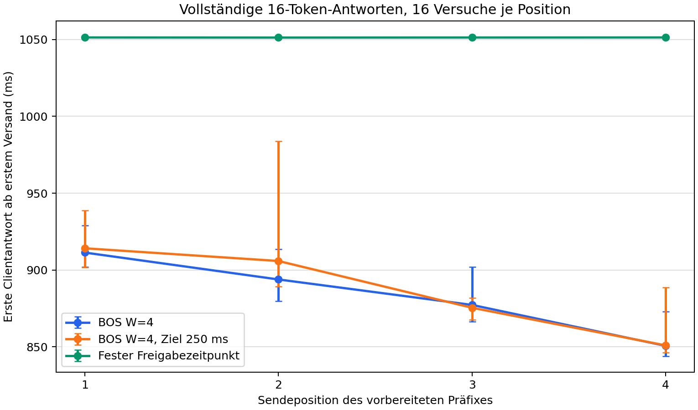

# BOS auf vollständigen LLM-Antworten: Rangschutz und verbleibende Clientzeit

Stand: 02.11.2026. Lokaler, kontrollierter Machbarkeitstest auf
Qwen2.5-7B-Instruct / vLLM 0.17.1 / RTX 3090. Dies ist der erste
**durchgängige** Vergleich mit einer tatsächlich antwortenden
Freigabeschicht. Der Befund betrifft einen bekannten vierfachen
Cachezustand in einer gezielten Prefill-Konfiguration, keine
Promptrekonstruktion bei fremden Nutzern.

## Kernergebnis

**Ein voller, zufällig gemischter Viererblock beseitigt den einfachen
Rangindikator, aber nicht die Information in der Zeit der ersten
Clientantwort.** Eine vor der Wiederholung festgelegte Regel, die nur
diese eine Clientzeit benutzt, erkannte nach Neustart von Server und
Proxy die vorgewärmte Sendeposition in **53/64** W=4- und **56/64**
250-ms-Durchläufen. Die zuerst empfangene Antwort-ID traf nur **21/64**
beziehungsweise **15/64**. Die vier Klassen waren je 16-mal vertreten.

Die Antwortfreigabe bei einem festen, am ersten Anfrageeingang
verankerten Zeitpunkt glättete *dieses* Zeitsignal im lokalen Pilot:
ein zuvor aus 16 Fällen gelernter Ein-Merkmal-Klassifikator traf im
späteren 64er-Lauf **18/64** Positionen. Dafür stieg die mediane
zusätzliche Wartezeit der vorgewärmten Antwort von rund **194 ms**
bei W=4 auf rund **363 ms**. Die feste Freigabe ist ein bekannter
Grundgedanke aus Traffic Shaping, hier nur als Vergleichsmechanismus
für vollständige LLM-Antworten getestet.

## Versuchsaufbau und Beobachter

- Backend: lokaler vLLM-Server auf `127.0.0.1:8765` mit aktivem Prefix-Cache,
  `max-model-len=2048`, `max-num-batched-tokens=256`,
  `long-prefill-token-threshold=64`, `gpu-memory-utilization=0.8`,
  `cpu-offload-gb=0`, Eager-Modus und FCFS-Standardpolicy. Diese
  Einstellung wurde schon vor diesem Schutzversuch als deutlicher
  Basiskanal identifiziert; sie ist **keine** allgemeine vLLM-Voreinstellung.
- Vier gleich lange Probes A–D mit je 548 Prompt-Tokens und genau
  16 Ausgabetokens. Vor jedem positiven Durchlauf wurde genau eine
  der vier Probes mit frischem gemeinsamem `cache_salt` vorgewärmt;
  weitere Durchläufe hatten keine Vorwärmung. Die vier Probes wurden
  rund 10 ms versetzt gesendet. Label und Sendeposition waren balanciert.
- Die Python-Freigabeschicht auf `127.0.0.1:8766` leitete Anfragen an
  vLLM weiter. Sie erfasste pro Antwort den **vollständigen Empfang der
  Backend-HTTP-Antwort am Proxy** (kein instrumentierter interner
  Modellfertigstellungszeitpunkt), den Beginn der Antwortfreigabe
  und das Ende des Sendens. Der Client erfasste Versand und vollständigen
  Empfang mit derselben monotonen Rechneruhr. Individuelle
  Proxy-Zusatzwartezeit: Freigabebeginn minus vollständiger
  Backend-Empfang. Der Proxy gab Antworten nacheinander mit einem
  geplanten Abstand von 2 ms frei; tatsächliche Zeiten stehen im Log.
- Im **abschließenden Kontrolllauf** entfernte der Proxy das direkte
  `cached_tokens`-Diagnosefeld aus allen 816 Clientantworten. Er
  protokollierte die 544 gecachten Tokens der jeweiligen vorgewärmten
  Probe intern zur Validierung. Die vorangehenden Serien ließen das
  Feld noch passieren, benutzten es aber nicht in Rang- oder Zeitregeln.
  Ein Dienst, der dieses Feld offenlegt, hätte unabhängig von BOS
  bereits einen direkten Cache-Kanal.

## Vier Freigaberegeln

1. **Direkt:** Jede vollständige Backend-Antwort sofort weitergeben.
2. **BOS W=4:** Vier vollständige Antworten sammeln, gleichverteilt
   mischen und freigeben. Wie der alte `BOSScrubber` begrenzt W nur
   die Blockgröße, keine individuelle Wartezeit.
3. **W=4 mit Ziel-Deadline:** Den Block bei vier Antworten oder beim
   Timer vom ersten vollständig empfangenen Backend-Ergebnis aus
   freigeben. Getestet: 100 und 250 ms. Eine erste naive Umsetzung
   löste den Timer exakt am Ziel aus und überschritt durch das
   nachfolgende serielle Senden 100 ms um bis zu 5,41 ms. Für die
   Hauptserie wurde der Timer um 10 ms vorgezogen; das ist eine
   **empirische Sicherheitsmarge**, kein harter Echtzeitbeweis.
4. **Fester Freigabezeitpunkt:** Ab dem ersten Anfrageeingang am Proxy
   1.050 ms warten, dann alle bereits vollständigen Antworten mischen
   und freigeben. Kommt eine Antwort danach, wird sie separat
   freigegeben und als `late_fallback` protokolliert. In den hier
   geprüften Gruppen trat dieser Fallback nicht ein. Diese Regel
   verankert die Ausgabe an einem vom Cachezustand unabhängigen
   Ereignis, kostet aber mehr Wartezeit.

## Ergebnisse der balancierten Hauptserie

In der ersten Hauptserie wurden die vier Regeln zufällig gemischt:
**272 Durchläufe / 1.088 Probes**, je Regel 64 vorgewärmte und vier
unvorgewärmte Durchläufe. Alle 1.088 Client- und Proxyantworten konnten
über ihre API-ID verbunden werden; 0 Zeitstempel- und 0 Cache-Kontrollfehler.
Tatsächliche und geplante Sendefolge sowie Proxy-Freigabe- und
Client-Empfangsfolge stimmten in jedem Durchlauf überein.

| Regel | Vorbereitete Probe auf Empfangsrang 1 | Vorbereitete Probe vollständig allein freigegeben | Median / Maximum individueller Zusatzwartezeit der vorbereiteten Probe |
| --- | ---: | ---: | ---: |
| Direkt | **64/64** | – | 0,04 / 0,08 ms |
| BOS W=4 | **19/64** | 0/64; alle Viererblöcke vollständig | 193,79 / 246,72 ms |
| W=4, Ziel 100 ms | **64/64** | **64/64** | 90,56 / 90,75 ms |
| W=4, Ziel 250 ms | **18/64** | 0/64; alle Viererblöcke vollständig | 194,31 / 235,57 ms |

Die 100-ms-Regel hielt in der Hauptserie bei allen 272 ihr
zugeordneten Probeantworten die **gemessene** Zusatzwartezeit unter
100 ms (Maximum 95,03 ms); sie schützte den Rang in diesem Aufbau
aber nicht. Die 250-ms-Regel bildete in 68/68 Durchläufen einen
vollen Viererblock, ohne gemessene Zielüberschreitung. W=4 ohne
Deadline hatte in diesen vierfachen Gruppen ebenfalls volle Blöcke;
bei ausbleibenden Anfragen gäbe es daraus allein keine Wartegrenze.

Die Ranghäufigkeiten von W=4 (19/19/16/10 über die Ränge 1–4) und
250 ms (18/15/12/19) sind mit einer gemischten Folge vereinbar;
eine kleine Stichprobe kann keine allgemeine Gleichverteilung oder
Sicherheit beweisen. Die Mechanik wählt die Permutation unabhängig
vom Backend-Eingang; die realen Client-Ränge wurden dennoch
einzeln geprüft.

## Restkanal in vollständigen Clientzeiten

Für jeden Durchlauf wurde

`T = Zeitpunkt der ersten vollständigen Clientantwort − Zeitpunkt des ersten Clientversands`

aus **nur clientseitigen** Zeiten gebildet. Je nach Sendeposition der
vorgewärmten Probe lagen die Mediane in der W=4-Hauptserie bei
**914,79 / 903,03 / 884,45 / 860,87 ms**. Ein voller BOS-Block wird
freigegeben, sobald die **letzte** Backend-Antwort da ist. Deren
Zeitpunkt hatte die entsprechenden Mediane 914,13 / 902,49 /
883,82 / 860,31 ms; die erste Clientantwort folgte danach im
Median rund 0,55 ms. Die gemischte Reihenfolge verschleiert also
den frühen Eingang, aber der Zeitpunkt des **Blockschlusses** bleibt
sichtbar. Das ist eine Beobachtung dieses Proxys, kein Trace der
internen vLLM-Scheduler-Entscheidungen.

Die vor der Wiederholung festgelegte Vierfachregel benutzt nur T:
Sie wählt die nächstgelegene der vier Medianzeiten aus der W=4-
Hauptserie und ordnet die geschätzte Sendeposition dem bekannten
Label zu. **Kein** Backend-Zeitpunkt, Cache-Diagnosefeld, Proxylog
oder Probeinhalt geht in die Vorhersage ein.

| Getrennte Prüfung nach Neustart von Backend und Proxy | Zeitregel korrekt | Zuerst empfangene ID korrekt |
| --- | ---: | ---: |
| W=4: 64 vorgewärmte Fälle | **53/64** | 21/64 |
| W=4, Ziel 250 ms: 64 vorgewärmte Fälle | **56/64** | 15/64 |

Diese zweite Serie umfasste 136 Durchläufe / 544 Probes; beide Regeln
hatten in allen 68 Fällen pro Regel volle Viererblöcke. Es gab keine
fehlenden Antworten oder Zeitstempelfehler. Die Genauigkeiten sind
**deskriptiv für diesen Aufbau**: derselbe Rechner, dasselbe Modell,
synthetische Prompts und weiterhin lokale HTTP-Verbindungen. Der
Klassifikator wurde nicht mit den 128 Testfällen nachgestellt.

Der Vergleich ist auch **innerhalb derselben Durchläufe** deutlich:
Bei W=4 war die Zeitregel in 36 Fällen richtig, in denen der
Rangindikator falsch lag; die umgekehrte Konstellation trat viermal
auf. Bei 250 ms waren es 46 gegenüber fünf Fällen. Das vermeidet
einen Vergleich verschieden zusammengesetzter Stichproben. Es sind
jeweils 64 wiederholte lokale Fälle, keine unabhängigen Nutzer oder
Server. Deshalb ist die Differenz ein belastbarer *lokaler*
Mechanismusbefund, noch keine übertragbare Angriffserfolgsrate.

## Feste Ausgabe als Vergleich

In einer gesonderten Serie bildete `slot1050` **68/68** volle Viererblöcke.
Die vorgewärmte Probe stand auf Rang 1 in 8/64 Fällen. Die erste
Clientantwort lag über die vier vorbereiteten Sendepositionen bei
Medianen von **1.051,33 / 1.051,34 / 1.051,36 / 1.051,36 ms**.
Eine aus 16 früheren Slot-Fällen gebildete gleichartige Ein-Merkmal-
Regel traf in diesen 64 späteren Fällen **18/64** Positionen. Das
zeigt nur die Unterdrückung **dieses einen** Zeitsignals, keine
Abwesenheit anderer Kanäle. Die mediane Zusatzwartezeit der
vorgewärmten Antwort betrug **362,50 ms**, maximal 380,78 ms.

Im letzten, **bereinigten** Lauf wurden W=4, 250 ms und Slot innerhalb
eines Serverstarts gemischt: 204 Durchläufe / 816 Probes, jeweils 64
vorgewärmte und vier Kontrollfälle. Alle Cache-Diagnosefelder fehlten
clientseitig, alle Treffer waren proxyintern korrekt, alle Gruppen
waren vollständig und es gab keine Zeitstempelfehler. Die unveränderte
Zeitregel aus der früheren W=4-Hauptserie traf **41/64** bei W=4 und
**43/64** bei 250 ms; die zuerst empfangene ID traf 14/64 und
16/64. Eine aus den 16 früheren Slot-Fällen gelernte Zeitregel traf
im bereinigten Slot-Lauf **12/64**. Damit bleibt der Restkanal auch
ohne direktes Cachefeld sichtbar, während die feste Freigabe die
hier geprüfte erste Antwortzeit stark glättet. Der absolute
Zeitklassifikator reagiert auf Laufzeitdrift; seine Genauigkeit
ist daher nicht ohne Kalibrierung auf andere Server übertragbar.
Auch in diesem bereinigten Lauf war die Zeitregel bei W=4 in 32
Fällen richtig, in denen der erste Rang falsch war (umgekehrt fünf),
und bei 250 ms in 33 Fällen (umgekehrt sechs). Für den Slot waren
es acht gegenüber zehn. Diese gepaarten Zählungen stützen die
Einordnung stärker als allein ein Vergleich der Trefferquoten.

In diesem bereinigten Lauf kostete der Slot die vorbereitete Probe
median **363,24 ms**, BOS W=4 **190,62 ms** Zusatzwartezeit;
die Differenz der getrennt gemessenen Mediane beträgt 172,62 ms.
Die Slot-Antwort begann am Proxy 1.050,37–1.057,47 ms nach dem
ersten Anfrageeingang. Das sind gemessene Werte, kein formaler
Deadline- oder Geheimhaltungsgarant.

## Einordnung und nächste Forschungsentscheidung

[PROMPTPEEK](https://www.ndss-symposium.org/wp-content/uploads/2025-1772-paper.pdf)
und [OptiLeak](https://arxiv.org/html/2602.20595v1) belegen bereits
Reihenfolge-/Positionsfeedback aus Cache-Sharing. Die eigene
ICCAI-2026-Arbeit und `ordleak` liefern die blockweise BOS-Idee.
[Accumulate and Serve](https://arxiv.org/pdf/1302.6123) und
[Pacer](https://www.usenix.org/system/files/sec22-mehta.pdf) behandeln
Pufferung und von geheimen Rechenzeiten entkoppelte Ausgabe als
bekannte Schutzprinzipien. Der **Kandidat für eine neue Erkenntnis**
ist enger: Bei vollständigen LLM-Antworten kann ein deadlinefähiges
BOS die Ränge mischen und trotzdem über den Zeitpunkt des
Blockschlusses viel von einem kontrollierten Cachezustand verraten;
ein festes Freigabeschema glättet dieses konkrete Signal zu messbaren
individuellen Kosten. Eine abschließende Neuheitsprüfung fehlt noch.

Die nächste Forschungsentscheidung sollte keine weitere lokale
Parameteroptimierung sein, sondern die **Übertragbarkeit** dieses
Schutz-/Kostenbefunds prüfen: andere gleichlange Promptinhalte,
andere Last und mindestens eine weniger stark eingestellte
Serving-Konfiguration. Dazu gehören vorab festgelegte Angreiferregeln
und getrennte Trainings-/Testläufe. Ein fester Slot kann bei
verspäteter Modellantwort nur entweder den Zeitpunkt verfehlen oder
eine Teilgruppe freigeben; diese Fallback-Häufigkeit und ihre
Informationswirkung müssen unter realistischeren Lasten untersucht
werden. Python-Timer und lokaler HTTP-Proxy liefern keine harte
Echtzeitgrenze. Die Studie umfasst keinen echten fremden Nutzer,
keine Promptrekonstruktion und keine Garantie gegen stärkere
Zeitbeobachter.

## Nachprüfbare Dateien

- Hauptserie: `../bos-pilot-20261102/trials-extended.jsonl`,
  `proxy-extended.jsonl`, `summary-extended.json` und `server.log`.
  Der frühere kleine Timer-Pilot liegt im selben Verzeichnis unter
  `trials-pilot.jsonl` / `proxy-pilot.jsonl`.
- Neustart-/Zeitregelprüfung: `../bos-holdout-20261102/trials.jsonl`,
  `proxy.jsonl`, `summary.json`, `timing-score.json`, `server.log`.
- Slot-Pilot und -Serie: `../bos-slot-20261102/trials-pilot.jsonl`,
  `trials-extended.jsonl`, `proxy.jsonl`, `proxy-extended.jsonl`,
  `summary-extended.json`. Sie nutzten den Backend-Server der
  Neustartprüfung.
- Abschließender bereinigter Vergleich: `trials.jsonl`, `proxy.jsonl`,
  `summary.json`, `timing-from-bos4.json`, `timing-from-slot.json`,
  `timingvergleich.png` in diesem Verzeichnis. Er nutzte ebenfalls
  den Backend-Server der Neustartprüfung.
- Implementierung und Auswertung: `../../src/order_release_proxy.py`,
  `../../src/bos_pilot.py`, `../../src/analyze_bos_pilot.py`,
  `../../src/analyze_timing_leak.py`, `../../src/plot_bos_timing.py`.
  Der Proxy schließt direkte Cachefelder im letzten Lauf aus;
  jedes JSONL enthält die echten Zeitpunkte und API-IDs.
