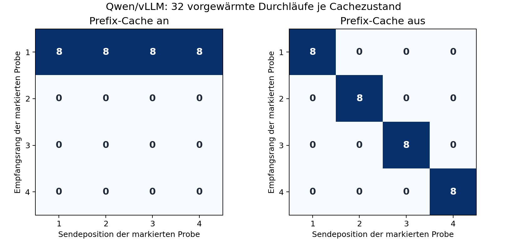

# Explorative Machbarkeit: sichtbarer Cache-Effekt in der Antwortreihenfolge

Stand: 02.11.2026. Lokaler Qwen2.5-7B-Instruct-Server mit vLLM 0.17.1 auf
einer RTX 3090. Dies ist ein kontrollierter Basiskanaltest, noch kein
BOS-Versuch und kein Angriff auf fremde Anfragen.

## Forschungsentscheidung

Ein hinreichend deutlicher **Rangkanal** ist in einer gezielt eingestellten
vLLM-FCFS-Konfiguration vorhanden. Die nächste sinnvolle kleine Etappe ist
damit eine Freigabeschicht, die vollständige Antwortreihenfolgen unter
blockweiser Mischung mit und ohne individuelle Wartezeitgrenze vergleicht.
Der Effekt gilt nicht für die zuvor getestete Standardbudget-Konfiguration.

## Aufbau und Beobachter

- Server: lokaler OpenAI-kompatibler HTTP-Endpunkt auf `127.0.0.1:8765`,
  Qwen2.5-7B-Instruct aus dem vorhandenen lokalen Snapshot, vLLM 0.17.1,
  `max-model-len=2048`, `gpu-memory-utilization=0.80`, `cpu-offload-gb=0`,
  `--enforce-eager`, FCFS-Standardpolicy und maximal ein Ausgabetoken.
  In beiden neuen Versuchsblöcken: `--max-num-batched-tokens 256` und
  ausdrücklich gesetztes `--long-prefill-token-threshold` (128 bzw. 64).
  Präfix-Cache jeweils an/aus als Kontrollpaar. Die Serverkonfiguration
  steht zusätzlich im jeweiligen Serverlog.
- Probes: A/B beziehungsweise A/B/C/D mit je 548 Prompt-Tokens und
  verschiedenem ersten Token. Vor jedem vorgewärmten Durchlauf genau eine
  Anfrage mit der ausgewählten Probe; die anschließenden Probes nutzen
  denselben frischen `cache_salt` innerhalb des Durchlaufs. Das ist eine
  bewusste gemeinsame Cache-Domäne. Probes wurden mit nominell 10 ms Abstand
  gesendet; tatsächliche Sendezeiten wurden mit `perf_counter_ns` erfasst.
  Eine Kontrollgruppe ohne Vorwärmung war enthalten.
- Die **Rangbeobachtung** ist ausschließlich die Reihenfolge, in der
  vollständige HTTP-Antworten beim lokalen Client ankommen. Antwort-ID und
  `cached_tokens` dienen nur zur Zuordnung und Kontrolle. Für ein reales
  API-Bedrohungsmodell muss das diagnostische Feld `cached_tokens` separat
  betrachtet oder abgeschaltet werden: hier war es mit
  `--enable-prompt-tokens-details` sichtbar, ging aber nicht in die
  Rangentscheidung ein.
- Alle HTTP-Antworten hatten Status 200, 548 Prompt-Tokens und ein
  Ausgabetoken. Tatsächliche Sende- und geplante Reihenfolge stimmten in
  sämtlichen 188 neuen Durchläufen überein. Die Sendeabstände lagen insgesamt
  zwischen 9,73 und 10,56 ms. Bei aktivem Cache meldete nur die jeweils
  vorgewärmte Probe 544 gecachte Tokens; bei deaktiviertem Cache gab es
  keine positiven Cache-Meldungen.

## Ergebnis

Die Zahlen in den Feldern sind Durchlaufzahlen. Die Grafik zeigt nur die
32 Versuche je Cachezustand mit einer zuvor gesendeten markierten Probe;
die acht zusätzlichen Kontrollen ohne Vorwärmung je Zustand fehlen darin.

| Bedingung | Durchläufe mit Vorwärmung | Später gesendeter Treffer auf Rang 1 | Kontrolle ohne Vorwärmung |
| --- | ---: | ---: | --- |
| Zweier, Budget 256, Schwelle 128, Cache an, zwei getrennte Serien | 48; davon 24 Treffer an Sendeposition 2 | **24/24** | 24/24: Empfangsfolge = Sendefolge |
| Zweier, gleiche Schwelle, Cache aus | 24; davon 12 an Sendeposition 2 | **0/12** | 12/12: Empfangsfolge = Sendefolge |
| Vierer, Budget 256, Schwelle 64, Cache an | 32; je 8 Treffer an Position 1–4 | **24/24** für Sendeposition 2–4; insgesamt Rang 1 in **32/32** | 7/8: exakte Folge; eine Vertauschung unter kalten Probes |
| Vierer, gleiche Schwelle, Cache aus | 32; je 8 markierte Probes an Position 1–4 | **0/24** für Sendeposition 2–4; deren Rang = Sendeposition in **32/32** | 7/8: exakte Folge; eine Vertauschung unter kalten Probes |

Im Zweieraufbau kam ein **10 ms später gesendeter** Cache-Treffer in den
beiden Cache-an-Serien 51,00–88,66 ms *vor* der kalten Probe an
(Median 82,5 ms über die 24 Fälle). Bei Cache aus kam die später gesendete
markierte Probe 19,36–50,74 ms *nach* der zuerst gesendeten an.

Im Viereraufbau kam der Cache-Treffer selbst bei Sendeposition 4 in
**8/8** Durchläufen zuerst an. Sein Vorsprung vor der frühesten kalten
Antwort betrug dort **297,68–310,07 ms** (Median 299,22 ms). Für
Sendepositionen 1, 2 und 3 lagen die Vorsprünge bei 469,42–534,04 ms,
388,44–402,01 ms und 356,39–359,54 ms. Bei Cache aus belegte die
entsprechend markierte Probe an jeder Sendeposition genau denselben Rang
(je 8/8). Die je eine Vertauschung in den beiden unvorgewärmten
Vierer-Kontrollgruppen betrifft zwei kalte Anfragen; exakte Gleichheit
aller kalten Ränge wird also nicht behauptet.

Der frühere [Zweierpilot](../order-feasibility-20261102/auswertung.md)
liefert die entscheidende Negativkontrolle zur **Konfiguration**: Bei
Tokenbudget 2048 gewann stets die zuerst gesendete Probe. Bei Budget 256
ohne explizite Prefill-Schwelle gab es nur nahezu gleichzeitige Antworten
mit maximal 0,093 ms Abstand und wechselndem Gewinner. Der hier deutliche
Rangabstand trat erst mit begrenztem Prefill pro Scheduler-Schritt auf.

## Einordnung der Ursache

Die [vLLM-0.17.1-Scheduler-Konfiguration](https://docs.vllm.ai/en/v0.17.1/api/vllm/config/scheduler/)
nennt FCFS als Standard, ein Tokenbudget pro Iteration und die Schwelle
für lange Prefills. Die [Optimierungsdokumentation](https://docs.vllm.ai/en/v0.17.1/configuration/optimization/)
beschreibt Chunked Prefill. Der lokal installierte vLLM-Schedulercode
(`vllm/v1/core/sched/scheduler.py`, insbesondere die Behandlung von
`long_prefill_token_threshold`) wurde zusätzlich gelesen. Die Ergebnisse
sind **vereinbar** damit, dass ein Cache-Treffer nur den Rest des Prefills
braucht und kalte 548-Token-Anfragen über mehrere Schritte laufen. Die
inneren Scheduling-Entscheidungen wurden nicht einzeln instrumentiert;
daher ist dies eine gestützte Mechanismushypothese, kein interner Trace.

[PROMPTPEEK, §II-B/§IV-A](https://www.ndss-symposium.org/wp-content/uploads/2025-1772-paper.pdf)
nutzt eine gezielt gefüllte Warteschlange und LPM-Priorisierung. Unser
lokaler Befund benutzt FCFS plus Chunked Prefill und ist kein Nachweis,
dass LPM hier aktiv wäre. Die Veröffentlichung von Cache-Leakage und
Rangbeobachtung ist bereits Vorarbeit; Neuheit wäre erst für einen
konkret ausgewerteten Schutz-/Kosten- und Restinformationsbefund zu prüfen.

## Grenzen und nächster Test

Ein Modell, ein Rechner, synthetische gleich lange Probes, lokale HTTP-
Verbindung und ein gezielt gesetztes kleines Tokenbudget. Die GPU bedient
auch den Desktop; Hintergrundlast wurde nicht systematisch variiert. Es
gibt weder reale fremde Nutzer noch Promptrekonstruktion oder Aussage zur
Übertragbarkeit auf produktive Standardkonfigurationen. Die positive
Cache-Kontrolle setzt gemeinsame Salt-Domäne voraus; tenantgetrennte Salts
würden diesen spezifischen Wiederverwendungsweg verhindern. Rang und
Clientzeit sind beobachtet, interne Modellfertigstellung und Freigabezeit
noch nicht.

Nächster Entscheidungstest: vier vollständige Antworten durch eine kleine
Freigabeschicht leiten, die zuerst ungeschützt durchreicht und dann
blockweise mischt. Je Antwort **Modellfertigstellung, Freigabe und
Clientempfang** getrennt erfassen; individuelle Zusatzwartezeit und
Restinformation aus vollständigen Rängen berichten. Eine Deadline-Variante
ist eine eigene Mechanismusänderung und braucht gesonderte Prüfung. Vor
einem Paper-Claim Literatur und Robustheit unter Konkurrenzlast vertiefen.

## Rohdaten und Wiederholung

- Zweier, Schwelle 128: `../prefill-threshold-20261102/trials.jsonl`,
  `trials-repeat.jsonl`, `trials-no-cache.jsonl` sowie entsprechende
  `server*.log` und `client*.log`.
- Vierer, Schwelle 64: `trials.jsonl`, `trials-no-cache.jsonl`,
  `server*.log` und `client*.log` in diesem Verzeichnis.
- Clients: `../../src/cache_order_pilot.py` und
  `../../src/full_order_pilot.py`; Plot: `../../src/plot_full_order.py`.
  Jede JSONL-Zeile enthält den Salt,
  Vorwärmzustand, geplante Folge, API-IDs, Sende-/Empfangszeit und
  Cache-Kontrollwerte. Beide Server wurden nach den Serien beendet.

Die 188 Durchläufe verteilen sich auf 36 + 36 + 36 Zweier- und 40 + 40
Vierer-Durchläufe. Die beiden Wiederholungen des Zweier-Cache-an-Tests
haben unterschiedliche randomisierte Fallfolgen und frische Salts, aber
denselben Rechner und dieselbe Modellinstanz-Konfiguration. Keine
unabhängige Stichprobe anderer Systeme.
